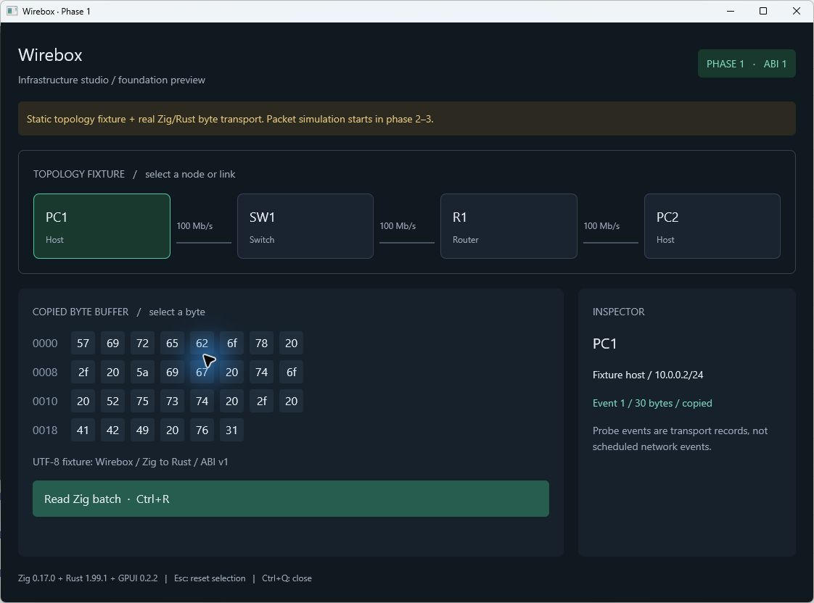

# G0 and G1 gate results — October 20, 2026

## Gate decision

| Gate | Status | Proven scope |
|---|---|---|
| G0 | Passed for local development, baseline v1 | Scope/expected results are frozen, fixtures are consistent, user-reported inventory along with unknowns are available, machines and proofing protocols are recorded |
| G1 | Local pass on Windows x64 debug | Zig/Rust/GPUI build, batch copy via ABI, ownership/error/lifecycle, fixture check, desktop interaction, and new source export |
| G2–G9 | Not tested | Scheduler, protocol, MVP, replay, adapter, intent executor, and real device pilot not yet available |

G0 does not indicate access to the VM/server or hardware has been tested. The remaining model/firmware/access dependencies remain logged in [inventory](../../../fixtures/inventory/pilot-v1.json), for G6/G8. The basis of this scope is set in [ADR-0005](../../adr/0005-pilot-scope.md) and [contract v1](../../wirebox/phase-0-contract.md).

## Environment and identity

[environment.json](environment.json) records the OS, CPU/RAM/GPU, compiler, and actual target. Source has no commits yet; [source-manifest.json](source-manifest.json) stores the SHA-256 of the associated build/kernel/host/fixture/ADR files. Cargo.lock stores versions and dependency checksums. Binaries are not included in the repository.

## Automatic verification

Actual command: `./scripts/verify.ps1`. Results are stored in [verification.log](verification.log).

| Examination | Results |
|---|---|
| Rustfmt workspace and Zig fmt | Pass |
| Zig unit tests | 3 passes: layout/copy, stale handle, session capacity and reuse |
| Compile C11 layout header | Pass: sizeof, alignof, offset, and handle width |
| Rust wrapper unit tests | 5 passes: copy/lifetime, batch/order/capacity, error, ABI/null/stale handle, layout |
| Unit test fixtures | 2 passes: fixture consistency and broken checksum detection |
| Compile-fail doctest | 1 pass: Session cannot be moved via thread::spawn |
| Clippy workspace/all-targets with `-D warnings` | Pass to source workspace |
| Runner `--probe` | The 30 bytes that Rust sends are copied by Zig and read back; session closed; result pass |
| Runner `--check-fixtures` | 4 nodes/5 scenarios validated as fixtures; checksum expected header valid; not running simulation |
| Build debug desktop | Passed with GPUI 0.2.2 on Windows MSVC |

Total tests: 3 Zig + 7 Rust units + 1 compile-fail doctest. This figure is not the number of network scenarios that have been run.

Cargo reports future-incompatibility in transitive dependency `proc-macro-error2 2.0.1` (private re-export proc_macro, E0365). Build on Rust 1.99.1 still works. This is recorded as a follow-up dependency when upgrading the toolchain; not hidden by lint source changes or untested third-party patches.

## New export source

Command: `./scripts/verify-clean-export.ps1`. [clean-export.log](clean-export.log) records the build workspace, ABI probe, and validation fixture from the new source directory in TEMP. No .git, targets, Zig static libraries, or source-side artifacts are copied.

Dependencies as well as the local compiler cache are reused via CARGO_TARGET_DIR. This is proof of a fresh-source build **with cache**, not a cold-cache install or remote CI run. The Windows workflow has been created in [.github/workflows/verify.yml](../../../.github/workflows/verify.yml), but has not been run on GitHub.

## Verify GPUI runtime

The target window is selected via Computer Use. Observed results:

- Node R1 is selected and the inspector shows the fixture address.
- Link SW1–R1 is selected and the inspector explains the link fixture.
- Byte offset 0 is selected and represents 0x57 / decimal 87 of the Zig buffer.
- Ctrl+R increases the event ID from 4 to 5 and reads a new batch copy.
- Escape returns selection to PC1.
- Ctrl+Q closes the window; log records `window_closed` and `session_destroyed`.

[ui-interaction.log](ui-interaction.log) also logs interactions before an automation step for which the actor is not specified; specific evidence of automation is the sequence above. After fixing the minimum window height to make the footer visible, the final build was re-inspected and the native close button was tested. [ui-final.log](ui-final.log) logs the final session and session destruction. Both stderr runs are empty; no crashes were found in that run.

The display is the fixture topology and probe transport, not a network simulation animation. The screenshot only contains the Wirebox window. Initial GUI builds require the use of window title APIs appropriate to the pinned GPUI package; the fix has entered source and the final build passed.

## Limits of proof

There is no packet scheduler, codec/field mapping protocol, ping simulator, snapshot/replay, device login, network mutation, p95 benchmark, 30 minute sessions, release packaging, or cross-platform testing. G1 proves basic stack/data and input limits. Next is P2-01 and the implementation of time semantics in [ADR-0003](../../adr/0003-virtual-time-and-trace.md).
